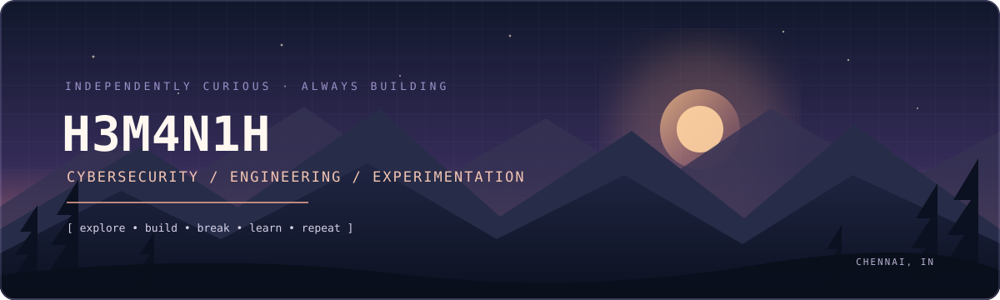

<!--
  H3M4N1H | GitHub profile README
  Landscape hero + concise portfolio sections.
-->

  

  <h3>Cybersecurity enthusiast · CTF player · Developer</h3>
  
<i>Learning how systems work, finding where they fail, and building things that make them better.</i>

  
  
  
  
  

---

## About

I'm **P. Hemanth Gupta**, a Computer Science and Engineering (Cyber Security) undergraduate at **Velammal Engineering College, Chennai**.

I spend my time exploring offensive security, solving CTF challenges, learning how software behaves under pressure, and building practical tools. I enjoy moving between security research and development — from understanding a vulnerability to writing code that helps investigate or prevent it.

- 🎯 **Focus:** Web security, penetration-testing fundamentals, networking and CTFs
- 🧪 **Building:** Security tools, automation and experimental projects
- 🏢 **Founder:** [NodeKraft](https://nodekraft.tech) — digital solutions and automation
- 🎨 **Community:** Creator Head & Core Member at Cyventura; Designer at Cybercom
- 📍 **Based in:** Chennai, India

## What I'm working on

| Area | Current focus |
|---|---|
| Offensive security | Web vulnerabilities, reconnaissance, Linux and practical VAPT workflows |
| CTFs | Web, crypto, misc and hands-on problem solving |
| Development | Python, Java, web technologies and useful automation |
| Research & experimentation | GLITCHLAB — a hardware fault-injection and resilience-testing research project |

## Tech stack

**Languages**

**Web & development**

**Security & tooling**

## Selected work

A few projects and experiments from my GitHub:

- **[GLITCHLAB](https://github.com/H3M4N1H/glitchlab)** — research-oriented hardware fault-injection and resilience-testing framework. *Private repository / active development.*
- **[SafeKey](https://github.com/H3M4N1H/SafeKey)** — local-first password manager focused on privacy and secure credential storage.
- **[CipherX](https://github.com/H3M4N1H/CipherX)** — terminal-based multi-layer cipher and encoding challenge solver.
- **[SpecterNet](https://github.com/H3M4N1H/SpecterNet)** — network capture and analysis suite.
- **[Aegis](https://github.com/H3M4N1H/Aegis)** — evidence-first SOC and deception-lab project.
- **[ThrustGuard](https://github.com/H3M4N1H/ThrustGuard-GUI)** — IoT behavioral trust scoring and anomaly detection.
- **[Snipe](https://github.com/H3M4N1H/snipe)** — alerts for hackathons, internships and CTF opportunities.

  

## CTF & achievements

- 🥉 **3rd Place — CryptClash CTF**, Techastra '26 (solo)
- 🥉 **3rd Place — VIT CyberQuest CTF**

I enjoy the process as much as the scoreboard: breaking down unfamiliar challenges, documenting what I learn, and improving my methodology with every event.

## GitHub activity

  <!-- Contribution streak -->
  <picture>
    <source media="(prefers-color-scheme: dark)" srcset="https://streak-stats.demolab.com/?user=H3M4N1H&hide_border=true&background=0D1117&stroke=8B7BC8&ring=B69AE8&fire=E7A58B&currStreakLabel=C9BCEB&sideLabels=9AA4B2&currStreakNum=F0EDF8&sideNums=F0EDF8&dates=7D8795" />
    
  </picture>

   

  <picture>
    <source media="(prefers-color-scheme: dark)" srcset="https://github-readme-stats.vercel.app/api?username=H3M4N1H&show_icons=true&hide_border=true&include_all_commits=true&count_private=true&hide_rank=true&bg_color=0D1117&title_color=B69AE8&icon_color=E7A58B&text_color=C5CBD5" />
    
  </picture>
  <picture>
    <source media="(prefers-color-scheme: dark)" srcset="https://github-readme-stats.vercel.app/api/top-langs/?username=H3M4N1H&layout=compact&langs_count=8&hide_border=true&bg_color=0D1117&title_color=B69AE8&text_color=C5CBD5" />
    
  </picture>

### Contribution graph

  <picture>
    <source media="(prefers-color-scheme: dark)" srcset="https://raw.githubusercontent.com/H3M4N1H/H3M4N1H/output/snake-dark.svg" />
    <source media="(prefers-color-scheme: light)" srcset="https://raw.githubusercontent.com/H3M4N1H/H3M4N1H/output/snake-light.svg" />
    
  </picture>

---

  <i>Curiosity over comfort. Consistency over shortcuts.</i>
   
  Thanks for stopping by — feel free to explore my work or connect.

